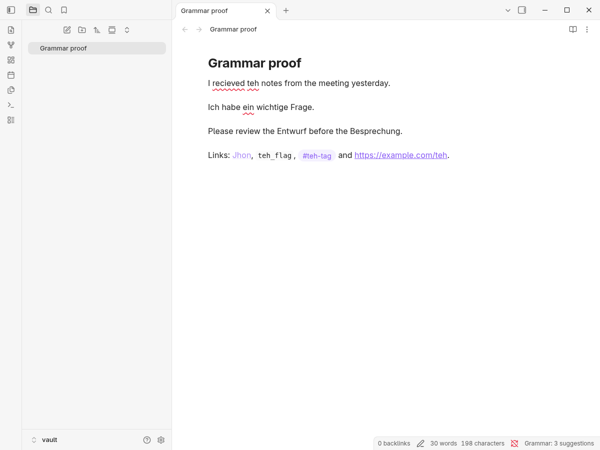
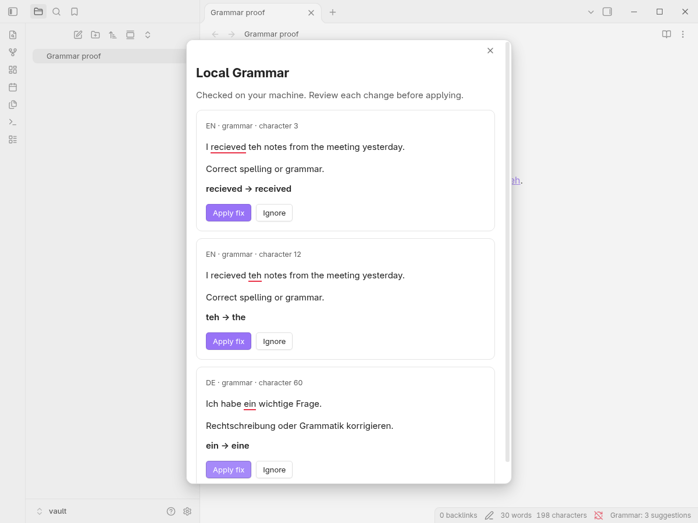
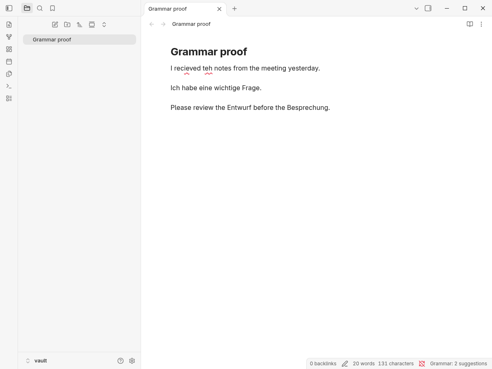
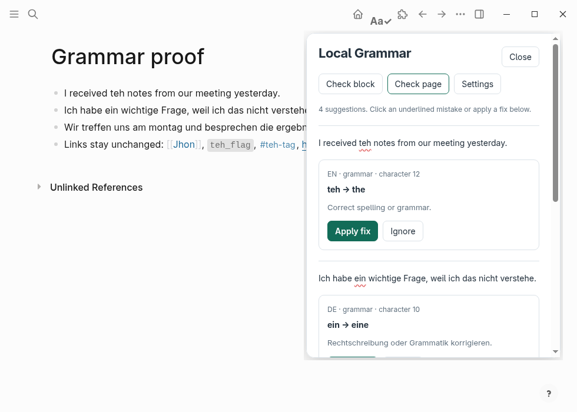
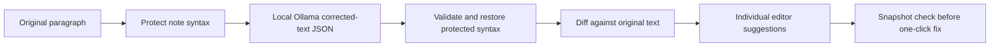

# local-grammar

English and German spelling and grammar suggestions inside **Logseq** and **Obsidian**, checked by a small local Ollama model.
No account, cloud model, external checking service, automatic rewrite, or automatic application of suggestions.
You review and apply each individual change.

## Screenshots

Real Obsidian 1.14.4 editor, a throwaway vault, `qwen3.5:4b`.
Mistakes get a wavy underline, while the mixed English/German sentence, `[[Jhon]]`, inline code, the tag, and the URL are left alone.





Real Logseq 0.10.15, a throwaway graph, **Check page**.
The panel lists each block's suggestions, and links, code and tags are untouched.



## Requirements and Ollama setup

- Desktop Logseq with file-based graphs, or desktop Obsidian with its CodeMirror 6 editor.
- [Ollama](https://ollama.com/download) running on the same machine.
- Node.js 22 or newer to build the plugins.
- Approximately 3 GiB of available GPU memory for the default model at the configured 4,096-token context, plus desktop/application overhead.
  Ollama can also run on CPU, but CPU latency was not measured here.

Install the default local model:

```sh
ollama pull qwen3.5:4b
```

If Ollama is not already running as an application or service, start `ollama serve` in a separate terminal.
The default endpoint is `http://localhost:11434`.
There is no need to expose Ollama to the network.

Only loopback URLs (`localhost`, `127.0.0.1`, or `[::1]`) are accepted.
Before sending any note text, the checker reads installed-model metadata and requires local GGUF weights.
Cloud models such as `minimax-m3:cloud`, remote-model aliases, unverified models, and HTTP redirects are rejected.
There is no fallback to another model or server.

## Build and install

From the repository root:

```sh
npm ci
npm run build
```

The build produces two independent plugin folders under `dist/`.
Both bundle the same shared checking core; neither needs a separate grammar-checking server besides Ollama.
The GitHub check workflow also builds downloadable `local-grammar-plugins` artifacts for reviewed changes.

### Obsidian

1. Create `<your-vault>/.obsidian/plugins/local-grammar/`.
2. Copy `main.js`, `manifest.json`, and `styles.css` from `dist/obsidian/` into that folder.
3. In Obsidian, enable community plugins for this vault, reload the app if necessary, and enable **Local Grammar**.
4. Open **Settings → Local Grammar** and confirm the Ollama URL and model.
5. Open a Markdown note in editing mode, not Reading view.

Mistakes have wavy underlines; missing punctuation has a small insertion marker.
Click a mark to review its suggestion, or use **Local Grammar: Show suggestion at cursor** (`Alt+Enter`).
That command selects the suggestion at the cursor, or the next one after it.
The suggestion modal includes the original context, replacement, a short explanation, **Apply fix**, and **Ignore**.
Applying a fix uses an editor transaction and rechecks the changed text.

Use **Local Grammar: Check current note and review all suggestions** (`Ctrl+Shift+G`, or `Cmd+Shift+G` on macOS) to review the entire current note.
Obsidian's hotkey settings can change these bindings if another command already uses them.
The status bar shows background progress, suggestion count, or unavailable state.

### Logseq

1. Enable **Developer mode** in Logseq's settings.
2. Open **Plugins**, choose **Load unpacked plugin**, and select `dist/logseq/` itself.
3. Open the plugin's settings and confirm the Ollama URL and model.
4. Open a block, type, and pause briefly.
5. Click **Aa✓** in the toolbar to open the review panel.

Logseq uses a block-review panel rather than modifying the application's editor DOM.
The panel shows the checked block text with underlined mistakes, individual suggestions, **Apply fix**, and **Ignore**.
Click an underlined mistake to focus its fix button.
This keeps Logseq links, properties, editing buffers, and the application's block ownership under its supported plugin API.
Marks appear in this panel, not directly inside Logseq's textarea.

Use **Local Grammar: check current block** (`Ctrl+Shift+G` / `Cmd+Shift+G`) or **Check block** in the panel for an on-demand check.
Use **Local Grammar: check current page** or **Check page** to review all blocks on the current page, including nested blocks.
Applying a fix re-reads the block, checks its exact snapshot, commits an active editing buffer if necessary, updates through `Editor.updateBlock`, and rechecks that block.
**Close** or `Escape` dismisses the panel without changing text.

This integration targets Logseq's file-based desktop graphs, not its DB version.

## Settings and background behavior

Each plugin exposes:

- **Ollama URL**: loopback only.
- **Model**: an installed local Ollama model name.
- **Check after a typing pause**: enabled by default.
- **English** and **German**: independently enabled or disabled.

Checks start after a 1.1-second typing pause.
Logseq observes its editing block through the plugin API every 450 ms; only a changed buffer schedules a model request.
Obsidian reacts to CodeMirror document changes and does not auto-check unfinished IME composition.
Typing never waits for a model response.
Starting a newer check aborts the previous request, and results are accepted only for the unchanged text snapshot.

The core checks paragraphs separately, allowing English and German paragraphs on the same page or note.
Language is detected by the model for each checked paragraph, not forced for the entire note.
A sentence containing words from both languages remains a single paragraph; mixed-language preservation is part of the measured sample set below.
Disabled languages produce no suggestions.

An in-memory cache reuses results for unchanged paragraphs, keyed by their text, endpoint, model, and enabled languages.
It retains at most 128 entries and does not write note text to disk.
Settings changes clear the cache and pending results.
**Ignore** dismisses a suggestion for the current text, not a permanent dictionary entry; changing the text or reloading the plugin allows it to be checked again.

## How checking and syntax protection work



The model returns complete corrected text and an `en` or `de` language tag, not character offsets.
The core derives original-text UTF-16 spans by diffing, so repeated words, insertions, deletions, German umlauts, and emoji do not depend on model-generated coordinates.
Suggestions contain the exact original substring, replacement, a short generic spelling/grammar or punctuation explanation, category, and language.
Categories are intentionally coarse: spelling and inflection corrections are grouped under `grammar`; punctuation-only changes use `punctuation`.
No style or tone rewriting is requested.

Protected constructs are replaced with ordered placeholders before checking:

- `[[wikilinks]]`, `![[embeds]]`, and Logseq `((uuid))` block references.
- `#tags` and complete Logseq `property:: value` lines.
- Inline code, including multiple-backtick and multiline spans, and fenced code blocks.
- URLs, Markdown links/embeds, frontmatter, LaTeX `$…$`, `$$…$$`, `\(…\)`, and `\[…\]`.
- Renderer macros, Markdown prefix/formatting markers, escapes, and HTML-like tags.

The checker rejects missing, duplicated, or reordered protected placeholders and rejects diff edits overlapping protected ranges.
Protected contents are intentionally not spell-checked, including link labels, code, and property values.
These protections use conservative range detection, not a full Markdown or LaTeX parser.
An unclosed code fence is treated as protected through the end of the text.

Malformed JSON, missing fields, truncated model output, empty paragraph removal, changed protected syntax, stale requests, and stale fix actions do not modify the note.
A paragraph larger than 4,000 characters after masking must be split with a blank line; the plugin reports this instead of silently skipping it.
A model request times out after two minutes, and a local-model metadata request after ten seconds.

## Choosing the model

**Default: `qwen3.5:4b` (Ollama, Q4_K_M, thinking disabled).**
No lighter candidate matched it on both preservation and accuracy, so it stays.

### How the candidates were found

- Ollama library small models, names verified against the library pages before pulling: `qwen3.5` (0.8b, 2b, 4b), `qwen3:1.7b`, `gemma3` (1b, 4b), `llama3.2` (1b, 3b), `stablelm2:1.6b`.
- Hugging Face, runnable through Ollama as GGUF:
  `hf.co/mradermacher/EuroLLM-1.7B-Instruct-GGUF:Q4_K_M` (multilingual instruct model) and
  `hf.co/Hanish/quill-fix-v1:Q4_K_M` (English grammar-fix fine-tune).
- Hugging Face models fine-tuned for grammatical error correction that cannot use the plugin's chat+JSON runtime, measured in throwaway environments instead:
  `AnthonyFC/langlm-gguf` (German, raw completion through Ollama) and
  `LiquidAI/LFM2.5-Encoder-350M-Spellchecker` (English token tagger on CPU with `transformers`).
- Found but not measured: `kotoshu/grammar-de` (German GECToR tagger as ONNX; needs a port of its Ruby tokenizer and is non-commercial) and the T5-family GEC models (`jbochi/coedit-small` GGUF, `aiassociates/t5-small-grammar-correction-german`), which Ollama cannot run.

| Model | Hugging Face / library | License | Parameters | Quantization |
|---|---|---|---:|---|
| qwen3.5:4b | [Qwen/Qwen3.5-4B](https://huggingface.co/Qwen/Qwen3.5-4B) | Apache-2.0 | 4.2B (Ollama) | Q4_K_M |
| qwen3.5:2b | [Qwen/Qwen3.5-2B](https://huggingface.co/Qwen/Qwen3.5-2B) | Apache-2.0 | 2.3B | Q4_K_M |
| qwen3.5:0.8b | [Qwen/Qwen3.5-0.8B](https://huggingface.co/Qwen/Qwen3.5-0.8B) | Apache-2.0 | 0.9B | Q4_K_M |
| qwen3:1.7b | [Qwen/Qwen3-1.7B](https://huggingface.co/Qwen/Qwen3-1.7B) | Apache-2.0 | 2.0B | Q4_K_M |
| gemma3:4b / 1b | [google/gemma-3-4b-it](https://huggingface.co/google/gemma-3-4b-it), [1b](https://huggingface.co/google/gemma-3-1b-it) | Gemma terms | 3.9B / 1.0B | Q4_K_M |
| llama3.2 (3b) / 1b | [meta-llama/Llama-3.2-3B-Instruct](https://huggingface.co/meta-llama/Llama-3.2-3B-Instruct), [1B](https://huggingface.co/meta-llama/Llama-3.2-1B-Instruct) | Llama 3.2 Community | 3.2B / 1.2B | Q4_K_M |
| stablelm2:1.6b | [stabilityai/stablelm-2-1_6b](https://huggingface.co/stabilityai/stablelm-2-1_6b) | Stability (other) | 1.6B | Ollama default |
| EuroLLM-1.7B-Instruct | [mradermacher/EuroLLM-1.7B-Instruct-GGUF](https://huggingface.co/mradermacher/EuroLLM-1.7B-Instruct-GGUF) | Apache-2.0 | 1.66B | Q4_K_M |
| quill-fix-v1 | [Hanish/quill-fix-v1](https://huggingface.co/Hanish/quill-fix-v1) | Apache-2.0 | 0.75B | Q4_K_M |
| langlm-de | [AnthonyFC/langlm-gguf](https://huggingface.co/AnthonyFC/langlm-gguf) | CC-BY-NC-4.0 (non-commercial) | 1.29B | Q4_K_M |
| LFM2.5 Spellchecker | [LiquidAI/LFM2.5-Encoder-350M-Spellchecker](https://huggingface.co/LiquidAI/LFM2.5-Encoder-350M-Spellchecker) | LFM 1.0 (other) | 0.36B encoder (0.71B loaded with reranker) | fp32 |

### Benchmark

63 synthetic paragraphs in `scripts/benchmark-samples.json`, measured on 2026-10-16:

- 39 paragraphs with an error and a single expected fix: 15 English spelling/grammar, 10 German spelling/grammar, 6 German noun-capitalization, 2 mixed English/German, 6 with protected note syntax.
- 24 controls that must stay byte-identical: 6 clean English, 6 clean German, 8 mixed English/German (loanwords and code-switching that must not be translated), 4 note-syntax cases.

Every Ollama model ran through the shipped `Checker` with identical prompt, schema, temperature `0`, 4,096-token context and syntax protection.
Rejected requests (for example a model changing protected syntax) show no suggestions and are scored as unchanged.
**Drift** counts paragraphs where more than 40% of the words differ from the input, which in practice means translation or rewriting.

Result with the translation guard described below, which is what the plugins ship:

| Model | Fixes exact (of 39) | Controls kept (of 24) | Drift | Rejected | Cold first request | Warm median | Ollama VRAM / RAM |
|---|---:|---:|---:|---:|---:|---:|---|
| **qwen3.5:4b** | **32** | **24** | 1 | 1 | 14.4 s | 1.72 s | 0.11 / 2.88 GiB |
| gemma3:4b | 32 | 22 | 1 | 2 | 13.5 s | 1.36 s | 0.10 / 2.63 GiB |
| llama3.2 (3b) | 30 | 16 | 0 | 1 | 3.0 s | 1.23 s | 0.09 / 2.34 GiB |
| qwen3.5:2b | 29 | 23 | 1 | 1 | 11.9 s | 1.20 s | 0.06 / 2.17 GiB |
| qwen3.5:0.8b | 29 | 20 | 2 | 1 | 10.4 s | 0.68 s | 0.48 / 0.00 GiB |
| qwen3:1.7b | 24 | 24 | 0 | 1 | 3.5 s | 0.78 s | 0.06 / 1.72 GiB |
| gemma3:1b | 15 | 20 | 1 | 4 | 3.2 s | 0.49 s | 0.06 / 0.78 GiB |
| llama3.2:1b | 15 | 22 | 0 | 5 | 3.4 s | 0.60 s | 0.08 / 1.37 GiB |
| stablelm2:1.6b | 12 | 18 | 1 | 8 | 2.3 s | 0.72 s | 0.22 / 1.53 GiB |
| EuroLLM-1.7B-Instruct | 1 | 24 | 0 | 10 | 3.8 s | 0.51 s | 0.06 / 1.37 GiB |
| quill-fix-v1 | 5 | 8 | 0 | 2 | 3.4 s | 0.77 s | 0.05 / 0.57 GiB |
| langlm-de (German paragraphs only, 16 + 6) | 16/16 | 6/6 | 0 | 0 | 1.4 s | 0.25 s | 0.84 / 0 GiB |
| LFM2.5 Spellchecker (English paragraphs only, 15 + 6) | 12/15 | 6/6 | 0 | 0 | 4.4 s | 0.29 s | CPU |

Without the guard, `qwen3.5:4b` kept 23 of 24 controls, `qwen3:1.7b` 22, `qwen3.5:2b` 19, `qwen3.5:0.8b` 18, `gemma3:4b` 19 and llama3.2 (3b) 12.
Raw models translated English paragraphs into German (`I recieved teh notes...` became `Ich habe die Notizen ... erhalten.` with `qwen3:1.7b`) and mixed controls into one language.

**Measurement caveat.** Other processes on this laptop held about 5 GiB of the 8 GiB GPU (a background speech service and another Python process), so Ollama kept almost every model mostly on the CPU (`VRAM / RAM` column) and the latencies are CPU-bound.
They show that these models work without a free GPU, not what a free GPU would give.
Fix and control counts are deterministic and unaffected.
Single-pass numbers on 63 hand-written paragraphs are a ranking aid, not a statistical benchmark or a Grammarly comparison.
The harness unloads every model currently loaded in Ollama before each candidate to measure a cold start.

### Decision

Order of criteria: preservation, then accuracy, then size and latency.

- `qwen3.5:4b` kept all 24 controls and fixed 32 of 39 errors, the best accuracy of any model that preserves everything. It is the only candidate with both, so it is the default.
- `qwen3:1.7b` also kept 24/24, but only because the guard discards the paragraphs it translated; it then fixes just 24 of 39 and leaves most English errors unfixed. The lighter model is a worse checker, not an equal one.
- `qwen3.5:2b` is the best lighter alternative: 29 fixes and 23 controls. Use it with `ollama pull qwen3.5:2b` if memory is tight.
- Models below 1B or 1.5B (`qwen3.5:0.8b`, `gemma3:1b`, `llama3.2:1b`, `stablelm2:1.6b`, EuroLLM, quill) either rewrite controls, fix too little, or are rejected often.
- Remaining `qwen3.5:4b` mistakes: `tasks is` became `task isn't`, `Im sommer ... strand` became `ans Strand`, a missing comma was not added, and the loanword `Rechnung` in an English sentence became `receipt`. Review every suggestion.

### Specialized correctors: faster, more precise, different runtime

Two Hugging Face correctors beat every general model on their own language and preserved all controls, but neither fits the current chat+JSON runtime, so the plugins do **not** use them:

- `langlm-de` fixed all 16 German errors and kept all 6 clean German sentences in about 0.25 s at 0.84 GiB. It is German-only, base-format (raw completion, one tokenised sentence at a time), and non-commercial (CC-BY-NC-4.0).
- `LFM2.5-Encoder-350M-Spellchecker` fixed 12 of 15 English errors and kept all controls on CPU in about 0.29 s. It is an encoder tagger run with `transformers` (not Ollama) under a custom license. Failures: `Its` became `Its 's`, `Their going` became `They are going` and a dropped verb in `tasks not finished`.

A hybrid of a German corrector, an English corrector and per-paragraph language routing could be lighter and more precise, but it needs a different runtime, paragraph language detection, and a licensing decision for the weights. That is a product decision, so it has not been built.

### Reproduce

```sh
ollama pull qwen3.5:4b
npm run benchmark -- /tmp/lg-bench qwen3.5:4b qwen3.5:2b qwen3:1.7b
npm run summarize -- /tmp/lg-bench
```

The runner writes per-sample rows, raw Ollama responses, memory metadata and the prompt/schema.
The per-sample rows behind the table above are committed in `benchmarks/2026-10-16/`; `npm run summarize -- benchmarks/2026-10-16` regenerates the table.
`scripts/external/langlm.py` and `scripts/external/lfm_tagger.py` reproduce the two specialized-model measurements in a scratch environment.

### Translation guard

Models sometimes translate a paragraph despite the prompt, and valid JSON does not prove that a correction preserved the meaning.
The core therefore discards a paragraph's result when at least 15 characters changed and more than 20% of its characters differ, which indicates a translation or rewrite rather than typo fixes.
Short fixes never trigger it.
The model also may not change protected syntax, and a rejected paragraph shows no suggestions.
Everything else remains an individually reviewable suggestion that is never applied automatically.

## Errors and CORS

If Ollama is unavailable, the plugin reports the local address, asks you to start `ollama serve`, and includes the exact `ollama pull <configured-model>` command.
A missing model has its own pull-command message.
Cloud or unverified models are rejected before any note text is sent.

The tested Obsidian `app://` and Logseq `file://` plugin builds reached the running local Ollama instance without changing CORS or disabling browser security.
If a different packaging/origin produces a CORS error, allow only that application's exact origin in Ollama's `OLLAMA_ORIGINS` configuration and restart your own Ollama service.
Do not expose Ollama publicly, set a blanket wildcard origin, disable web security, or substitute a cloud model to work around a connection error.

## Development and verification

```sh
npm test
npm run typecheck
npm run build
```

Core tests cover exact spans and application, whole-word suggestions, repeated words, insertions/deletions, UTF-16 offsets, protected syntax, multi-backtick code, mixed-language paragraphs, the translation guard, edge whitespace, disabled languages, recorded real model outputs, paragraph cache reuse, cancellation, actionable errors, and cloud/remote-model rejection.
They run without a GPU, Ollama, app installation, or network access.
CI runs the same tests, type check, and builds on Node.js 22.

The plugins were exercised in real desktop Logseq 0.10.15 and Obsidian 1.14.4 using a throwaway graph and vault.
Typing produced visible suggestions and one-click fixes changed only the selected mistake.
Obsidian's real-editor stale-modal scenario was also exercised: after replacing the underlying note, an obsolete fix is rejected and the new text remains unchanged.
No personal graph or vault is needed for development or validation.

Source layout:

- `src/core/`: local-model guard, prompt, parsing, syntax ranges, diff spans, cache, and application helpers.
- `src/obsidian/`: CodeMirror decorations, note review modal, commands, and settings.
- `src/logseq/`: supported block API, review panel, commands, and settings.
- `scripts/`: bundling and reproducible synthetic model comparison.
- `tests/`: deterministic core behavior and recorded-output fixtures.

Marketplace publication, mobile support, DB-version Logseq graphs, cloud accounts/models, external language-checking servers, and rewriting/tone tools are out of scope.
